# ShopCart

Plataforma web de ventas para el **Tech Challenge 360** de Grupo Pentandra. Una red de estaciones de servicio que hoy vende lubricantes, accesorios y productos de conveniencia solo en sus estaciones quiere su tienda en línea, con envío a domicilio o para **recoger en la estación**: catálogo con variantes, carrito, cupones, checkout con pago, seguimiento de pedidos, inventario con kardex, reportes y bitácora.

> El catálogo está inspirado en lo que vende una red de estaciones en Guatemala, pero **los productos, precios y existencias son de referencia (inventados)** y no se usan el logo, las fotos ni la identidad de esa empresa. Cada producto muestra una foto de referencia enlazada por URL: el empaque real para los de marca (Castrol, Havoline, Petronas, Repsol, Bardahl), tomado del fabricante o de tiendas en línea, y fotos de Unsplash o de tiendas para los de marca propia. Las fotos no se copian al repositorio. No se vende combustible ni nada con alcohol.

Este repositorio es el **proyecto completo**:

- **Fase 1:** base de datos y backend.
- **Fase 2:** frontend en React para los tres roles. El **cliente** compra; el **operador** prepara pedidos, registra devoluciones y lleva el inventario; el **administrador** además ve el dashboard en vivo y administra catálogo, cupones y usuarios.

| | |
|---|---|
| Base de datos | SQL Server 2019+ (uso 2022 en Docker, con la base en **nivel de compatibilidad 150 = 2019**) |
| Backend | Node.js 24 LTS, Express 5, TypeScript en modo `strict` |
| Acceso a datos | **Exclusivamente stored procedures** (88 SPs). Cero SQL en el código del backend, sin ORM |
| Frontend | React 19, TypeScript `strict`, Vite, Tailwind CSS + shadcn/ui, TanStack Query, Socket.IO |
| Pruebas | 72 pruebas de integración del backend contra SQL Server real y 39 pruebas del frontend |
| Tienda y panel | `http://localhost:8080` (Docker) o `http://localhost:5173` (desarrollo) |
| Documentación de la API | Swagger en `http://localhost:3000/api/docs` |

| Tienda | Dashboard en vivo | Seguimiento en el celular |
|---|---|---|
| 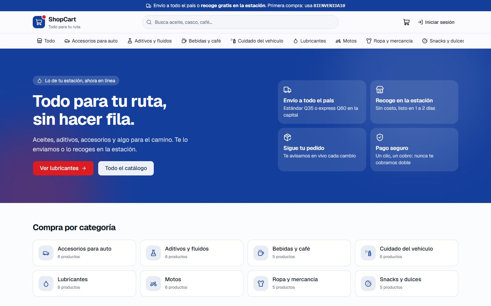 | 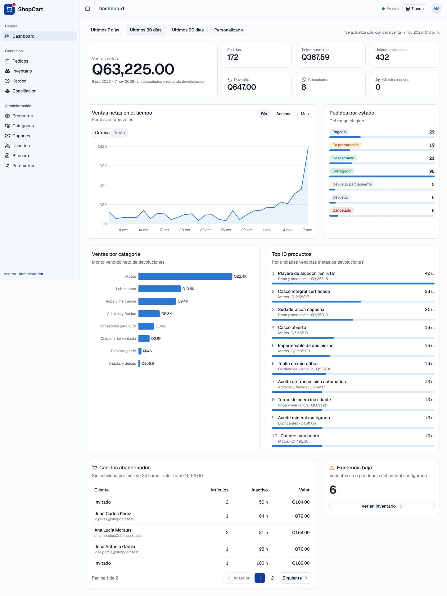 | 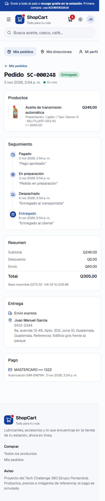 |

---

## Contenido

1. [Cómo levantarlo](#1-cómo-levantarlo)
2. [Credenciales y datos de prueba](#2-credenciales-y-datos-de-prueba)
3. [Pruebas automatizadas y demostraciones](#3-pruebas-automatizadas-y-demostraciones)
4. [Frontend](#4-frontend)
5. [Arquitectura](#5-arquitectura)
6. [Modelo de datos (diagrama entidad-relación)](#6-modelo-de-datos)
7. [Ciclo de vida del pedido](#7-ciclo-de-vida-del-pedido)
8. [Cómo se cumple cada regla del negocio](#8-cómo-se-cumple-cada-regla-del-negocio)
9. [Seguridad](#9-seguridad)
10. [Tiempo real](#10-tiempo-real)
11. [API: endpoints, formato de respuestas y catálogo de errores](#11-api)
12. [Decisiones técnicas y supuestos](#12-decisiones-técnicas-y-supuestos)
13. [Estándar de nomenclatura](#13-estándar-de-nomenclatura)
14. [Qué sigue / mejoras posibles](#14-qué-sigue--mejoras-posibles)

---

## 1. Cómo levantarlo

### Opción A: todo con Docker (recomendada para una máquina limpia)

Solo necesitas Docker Desktop (o Docker Engine con el plugin compose).

```bash
git clone https://github.com/JuanmaGt77/shopcart.git
cd shopcart
cp .env.example .env
docker compose up -d --build
```

Eso levanta, en este orden:

1. **`db`**: SQL Server 2022 (espera a estar sano con un healthcheck).
2. **`db-init`**: ejecuta en orden los scripts de `database/scripts/` (tablas, índices, funciones, vistas, triggers, SPs, permisos, semillas) y al final una **verificación de integridad** que detiene todo si algo no cuadra. Si la base ya existe no hace nada.
3. **`api`**: la API en `http://localhost:3000`.
4. **`web`**: el frontend compilado, servido por nginx en `http://localhost:8080`. nginx también reenvía `/api` y `/socket.io` a la API, así el navegador habla con un solo origen.

En uno o dos minutos (la primera vez compila las imágenes) queda listo:

- **Tienda y panel: <http://localhost:8080>**. En el login hay botones para entrar con las cuentas de prueba.
- Swagger: <http://localhost:3000/api/docs>
- Salud: <http://localhost:3000/api/salud>

> El `.env.example` trae claves de ejemplo que funcionan para probar en local. Antes de publicar en cualquier lado cambia `DB_SA_PASSWORD`, `DB_APP_PASSWORD` y `JWT_ACCESS_SECRET` (la API avisa en el log si sigue el secreto de ejemplo).

Para recrear la base desde cero (por ejemplo después de muchas pruebas o de correr las demos). La API se detiene primero porque mantiene conexiones abiertas a la base:

```bash
docker compose stop web api
docker compose run --rm db-init --reset
docker compose up -d
```

### Opción B: base en Docker y API y frontend en local (desarrollo)

```bash
cp .env.example .env
docker compose up -d db db-init

cd backend
cp .env.example .env      # las claves por defecto coinciden con las del .env de la raíz
npm install
npm run dev               # http://localhost:3000 con recarga automática

# en otra terminal
cd frontend
npm install
npm run dev               # http://localhost:5173; Vite reenvía /api y /socket.io a la API
```

Si la API corre en otro puerto, copia `frontend/.env.example` a `frontend/.env` y cambia `API_PROXY_TARGET`.

### Opción C: con un SQL Server propio (sin Docker)

La base se puede crear de tres formas, todas ejecutan los mismos scripts numerados:

```powershell
# Windows con sqlcmd
.\database\run-all.ps1 -Servidor "localhost,1433" -ClaveSa "TuClaveDeSa" -ClaveApp "ClaveParaLaApp_1"
```

```bash
# Linux / macOS con sqlcmd
DB_SA_PASSWORD='...' DB_APP_PASSWORD='...' ./database/run-all.sh
```

```bash
# Sin sqlcmd, solo con Node (usa DB_ADMIN_USER / DB_ADMIN_PASSWORD del backend/.env)
cd backend && npm install && npm run db:setup      # o npm run db:reset para recrearla
```

Después: `cd backend && npm run dev`.

### Comandos útiles del backend

| Comando | Qué hace |
|---|---|
| `npm run dev` | API en modo desarrollo |
| `npm run build` / `npm start` | Compila a `dist/` y la ejecuta |
| `npm test` | Pruebas de integración (crea la base `ShopCart_Test` desde cero) |
| `npm run typecheck` / `npm run lint` | TypeScript estricto y ESLint |
| `npm run db:setup` / `npm run db:reset` | Crear / recrear la base sin sqlcmd |
| `npm run demo:concurrencia` | Demo: N clientes por la última unidad |
| `npm run demo:idempotencia` | Demo: doble clic al pagar |
| `npm run demo:cupon` | Demo: cupón con límite usado en paralelo |
| `npm run realtime:escuchar` | Muestra en vivo los eventos del WebSocket |

### Comandos útiles del frontend

| Comando | Qué hace |
|---|---|
| `npm run dev` | Tienda y panel en `http://localhost:5173` con recarga automática |
| `npm run build` / `npm run preview` | Compila a `dist/` (con revisión de tipos) y lo sirve para probarlo |
| `npm test` | Pruebas unitarias con Vitest |
| `npm run typecheck` / `npm run lint` / `npm run format` | TypeScript estricto, Oxlint y Prettier |

---

## 2. Credenciales y datos de prueba

| Rol | Correo | Contraseña |
|---|---|---|
| Administrador | `admin@shopcart.test` | `Admin123!` |
| Operador | `operador@shopcart.test` | `Operador123!` |
| Cliente (con pedidos de ejemplo) | `cliente@shopcart.test` | `Cliente123!` |
| Otros 20 clientes | `maria.lopez@shopcart.test`, `jc.perez@shopcart.test`, ... | `Cliente123!` |

Uso el dominio `.test` porque está reservado para pruebas (RFC 2606).

**Las semillas incluyen:**

- **8 categorías:** Ropa y mercancía, Aditivos y fluidos, Cuidado del vehículo, Lubricantes, Motos, Accesorios para auto, Snacks y dulces, y Bebidas y café.
- **48 productos con 168 variantes.** Los atributos son talla, color, viscosidad, presentación, sabor, tipo, etc.
- Un producto de edición limitada con 2 y 3 unidades, y uno descontinuado.
- 22 departamentos y 3 métodos de envío: estándar, express y **recoger en estación**.
- ~320 pedidos de los últimos 90 días en todos los estados, con cancelaciones y devoluciones.
- Carritos abandonados y estos cupones:

| Cupón | Para demostrar |
|---|---|
| `BIENVENIDA10` | 10 %, compra mínima Q100, un uso por cliente |
| `AHORRA50` | Q50 fijos con compra mínima de Q300 |
| `LUBRICANTES15` | 15 % solo en la categoría Lubricantes (tope Q150) |
| `MOTO20` | 20 % solo en Motos, máximo 2 usos por cliente |
| `VERANO2025` | vencido |
| `AGOTADO5` | ya alcanzó su límite de 5 usos |
| `BLACKFRIDAY25` | programado, todavía no vigente |
| `PAUSADO10` | desactivado |
| `DEMO500` | Q500 sin mínimo: el total nunca queda negativo |

**Tarjetas de prueba** (la pasarela es simulada): `4111 1111 1111 1111` aprobada · `4000 0000 0000 0002` rechazada · `4000 0000 0000 9995` sin fondos. Cualquier fecha futura `MM/AA` y CVV de 3 dígitos.

---

## 3. Pruebas automatizadas y demostraciones

### Pruebas de integración (`npm test`)

72 pruebas con Vitest + Supertest que levantan la app real contra un SQL Server real (base `ShopCart_Test`, recreada con los mismos scripts en cada corrida). Cubren los criterios de aceptación uno por uno:

| Archivo | Qué comprueba |
|---|---|
| `seguridad.test.ts` | que **no exista SQL en `src/`**, registro y login, 401 con token vencido o alterado, 403 por rol, rotación del refresh token y detección de reuso, desactivar usuario corta el acceso al instante, rate limit (429), cabeceras de seguridad |
| `aislamiento.test.ts` | un cliente no puede ver ni modificar pedidos, direcciones, checkouts ni carritos de otro cambiando IDs (403) |
| `catalogo-inventario.test.ts` | búsqueda con filtros, orden y paginación; comodines escapados; producto con ventas se desactiva y no se borra; cambio de precio no altera pedidos; ajustes con motivo y sin negativos; existencia = suma del kardex |
| `carrito-cupones.test.ts` | no se agrega más de lo disponible, totales sin errores de redondeo, invitado y fusión, cada motivo de rechazo de cupón con su mensaje, descuento nunca negativo, cupón por categoría, límite por cliente y **límite total con 8 pagos simultáneos** |
| `checkout-pedidos.test.ts` | **10 clientes por la última unidad: solo uno**, **doble clic: un pedido y un cobro**, precio congelado, **atomicidad**, **reserva vencida liberada sola**, transición inválida rechazada en la API **y en la base**, historial de estados, cancelación y devoluciones |
| `reportes-bitacora.test.ts` | reportes netos de cancelaciones y devoluciones, ventas por día/semana/mes, categorías, top 10, caché con invalidación, **tiempos < 1 s**, bitácora con valor anterior/nuevo e inmutable |
| `tiempo-real.test.ts` | eventos por WebSocket: existencias, pedidos nuevos, cambios de estado solo al dueño, sesión revocada |

### Demostraciones en vivo

Con la API corriendo (`npm run dev`):

```bash
npm run demo:concurrencia -- 15   # 15 clientes por la última unidad: solo 1 la consigue
npm run demo:idempotencia         # 5 clics a la vez en Pagar + reintento: 1 pedido, 1 cobro
npm run demo:cupon                # cupón de 3 usos, 10 pagos simultáneos: exactamente 3
npm run realtime:escuchar         # en otra terminal: ves los eventos aparecer en vivo
```

Para probar la API a mano desde VS Code está **`backend/pruebas-api.http`** (extensión *REST Client*): una compra completa, doble clic en pagar, accesos por rol, aislamiento entre clientes, ciclo de vida del pedido, reportes y bitácora. Se ejecuta petición por petición con *Send Request*.

Y para mostrar que **la base protege las reglas aunque alguien se salte la API**, en `database/pruebas/` hay scripts que se abren y ejecutan tal cual en SSMS, Azure Data Studio o VS Code (extensión SQL Server):

| Script | Muestra |
|---|---|
| `01_FlujoCompraCompleto.sql` | flujo completo solo con SPs (carrito, checkout, pago, pago repetido, cancelación) dentro de una transacción que al final se revierte |
| `02_ReglasProtegidasEnLaBase.sql` | 10 intentos de romper reglas con UPDATE/INSERT directos y cómo los rechaza la base (trigger de transiciones, CHECKs, UNIQUEs, inmutabilidad) |
| `03_PermisosUsuarioAplicacion.sql` | el usuario de la API solo puede ejecutar SPs: no puede leer tablas ni borrar la bitácora |
| `04_ConcurrenciaUltimaUnidad.sql` | la prueba de la última unidad a mano con dos ventanas de SSMS |

### Pruebas del frontend (`cd frontend && npm test`)

39 pruebas con Vitest sobre la lógica que decide lo importante:

| Archivo | Qué comprueba |
|---|---|
| `api/cliente.test.ts` | Varias peticiones con el token vencido al mismo tiempo: el token se **renueva una sola vez** y todas se repiten. Además: sesión revocada cierra la sesión, errores por campo y filtros vacíos fuera de la URL |
| `checkout/checkout.test.ts` | **Idempotency-Key estable** en reintentos por red o 5xx y nueva solo cuando la API rechazó el intento; validación de tarjeta (Luhn, vencimiento) y formatos |
| `catalogo/seleccion-variante.test.ts` | Selector de variantes: valores en orden de alta, combinaciones agotadas o inexistentes y ajuste automático |
| `catalogo/admin/combinaciones.test.ts` | Generador de variantes del administrador: combinaciones y SKU válidos (sin tildes, ¼, ×) |
| `auth/destino.test.ts` | Después del login solo se redirige a rutas internas (sin redirección abierta) y cada rol va a su área |
| `lib/csv.test.ts` | Exportación a CSV: tildes legibles en Excel, comillas escapadas y **textos que Excel tomaría como fórmula neutralizados** (inyección de CSV) |
| `reportes/series.test.ts`, `lib/*.test.ts`, `bitacora/comparar.test.ts` | Días sin ventas en cero, montos en quetzales, fechas en hora de Guatemala, paginación y comparación de la bitácora |

### Guion de demostración en el navegador

Con todo levantado (`http://localhost:8080`):

1. **Compra completa:**
   - Como visitante, agrega un aceite al carrito.
   - Al pagar te pide iniciar sesión (botón *Cliente*); el carrito de invitado se pasa a la cuenta.
   - Elige **Recoger en estación** y aparta los productos: corre la **reserva de 15 minutos**.
   - Paga primero con la tarjeta *Rechazada* (se muestra el motivo) y luego con *Aprobada*.
2. **Tiempo real:**
   - Abre el panel en otra ventana como *Admin*: el dashboard y el inventario cambian solos con cada compra.
   - Como *Operador*, avanza el pedido a *En preparación*: el cliente ve moverse la línea de tiempo sin recargar.
3. **Cupones:**
   - `BIENVENIDA10` con un carrito chico muestra cuánto falta para el mínimo.
   - `LUBRICANTES15` solo descuenta los lubricantes.
4. **Doble clic en Pagar:** el botón se bloquea y, aunque llegara dos veces, la `Idempotency-Key` es la misma (un pedido, un cobro).
5. **Última unidad:** la *Playera conmemorativa* tiene 2 y 3 unidades. Dos clientes la apartan a la vez: uno pasa y el otro recibe el mensaje de existencia.
6. **Desactivar a un usuario:** el admin desactiva a una clienta conectada y su sesión se cierra al instante con un aviso.
7. **Celular:** todo funciona en 375 px. Las tablas del panel se vuelven tarjetas, y el menú y los filtros se abren en un panel lateral.

---

## 4. Frontend

| Catálogo | Carrito | Checkout con reserva |
|---|---|---|
| 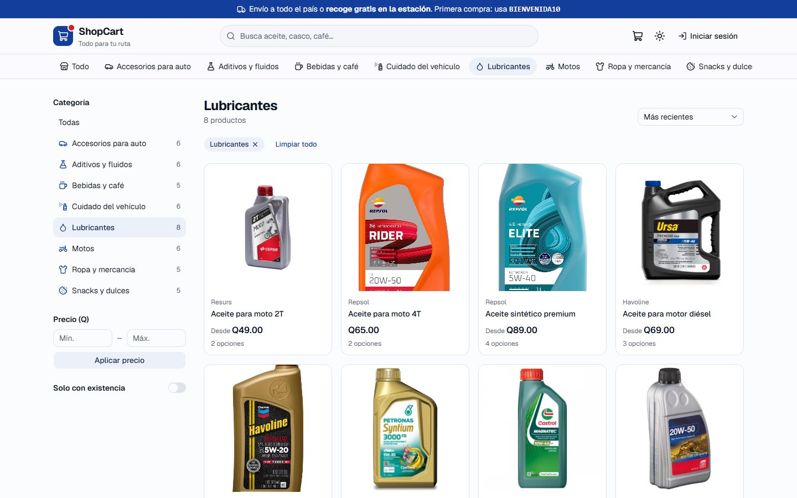 | 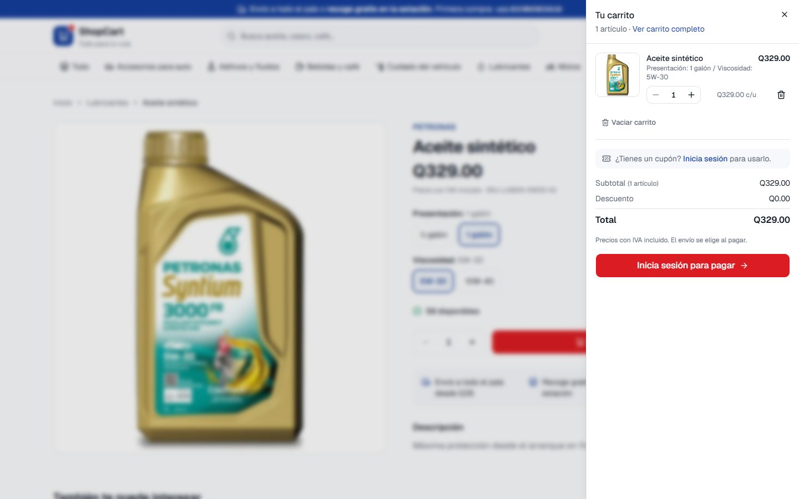 | 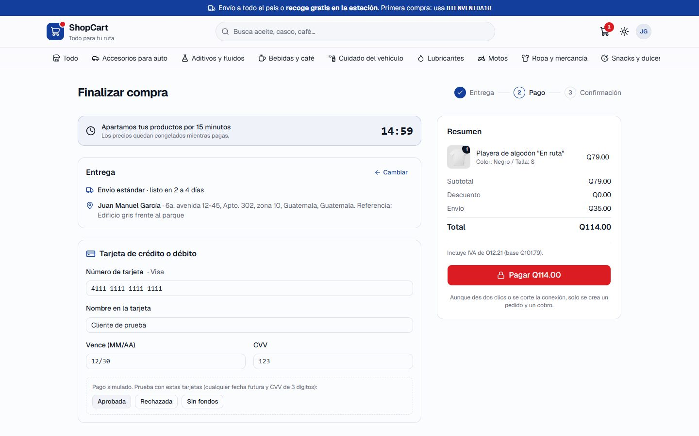 |

| Pedidos (operador) | Detalle del pedido (operador) | Producto (administrador) |
|---|---|---|
| 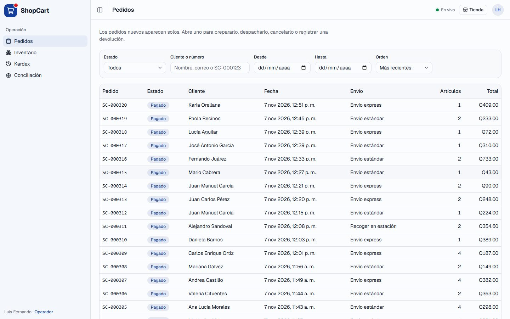 | 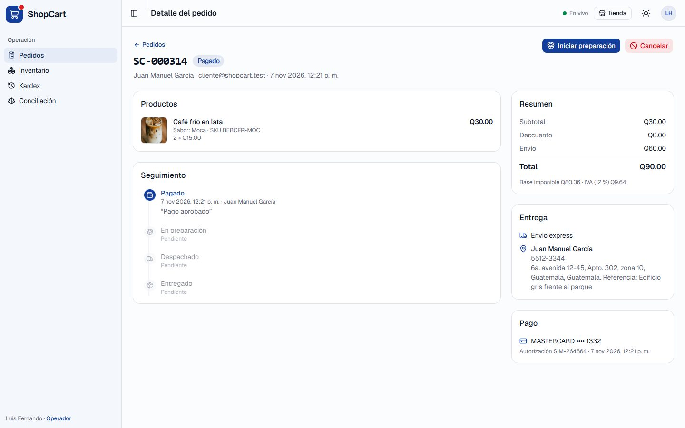 | 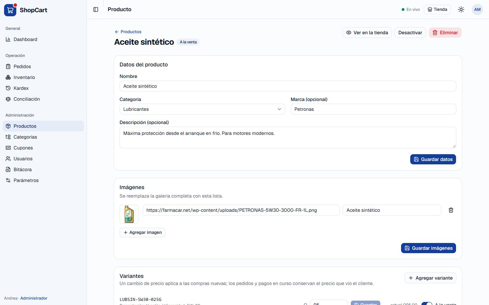 |

### Pantallas por rol

| Rol | Pantallas |
|---|---|
| Visitante | Inicio, catálogo con búsqueda y filtros, detalle con selector de variantes, carrito de invitado, login y registro |
| Cliente | Lo anterior, más: checkout (dirección, envío, reserva, pago), mis pedidos con seguimiento en vivo y cancelación, mis direcciones y mi perfil |
| Operador | Pedidos (filtros, cambios de estado, cancelación, devoluciones), inventario con movimientos, kardex y conciliación |
| Administrador | Todo lo del operador, más: dashboard en vivo (con exportación a CSV), productos y precios, categorías, cupones, usuarios, bitácora y parámetros |

El menú y las rutas siguen el mismo acceso por rol que la API. El operador no ve el dashboard ni la administración, y el personal no compra con su cuenta de trabajo. **Quien decide es la API**: el frontend solo evita mostrar pantallas que de todos modos responderían 403.

### Cómo está organizado

Cada módulo del frontend se llama igual que su módulo del backend, así una funcionalidad se sigue de punta a punta:

```
frontend/src/
├── api/              cliente HTTP ({ datos } / { error }, renovación del token, errores tipados) y claves de caché
├── app/              proveedores, router (rutas por rol, carga diferida), layouts de la tienda y del panel
├── tiempo-real/      conexión Socket.IO y sincronizador: cada evento -> la consulta que se refresca
├── modulos/          auth, catalogo (y catalogo/admin), carrito, checkout, cuenta, direcciones, pedidos
│                     (y pedidos/panel), inventario, cupones, usuarios, reportes, bitacora, sistema
├── components/       ui/ (shadcn/ui: el código vive en el repo) y compartidos (tabla responsiva, paginador, estados)
├── hooks/  lib/      filtros en la URL, formatos de quetzales y fechas en hora de Guatemala
```

Dentro de cada módulo: `api.ts` (llamadas y tipos) → hooks de TanStack Query → componentes y páginas.

### Librerías y por qué

| Librería | Para qué | Por qué esta |
|---|---|---|
| React 19 + Vite 8 | interfaz y compilación | lo pide el reto (React 18+); Vite da recarga instantánea y un proxy para hablar con la API desde el mismo origen |
| TypeScript `strict` | tipos | las mismas reglas que el backend (`noUncheckedIndexedAccess`, etc.) |
| React Router 8 | rutas | rutas anidadas por rol y carga diferida de cada área |
| TanStack Query | datos del servidor | caché, estados de carga y error, reintentos; los eventos del WebSocket solo invalidan la consulta afectada |
| Tailwind CSS 4 + shadcn/ui (Radix) | interfaz | componentes accesibles (teclado, foco, lectores de pantalla) cuyo código queda en el repo y se puede leer; responsive con utilidades |
| React Hook Form + Zod | formularios | validan con las mismas reglas que la API y pintan en cada campo los errores que devuelve |
| socket.io-client | tiempo real | el mismo protocolo del servidor, con reconexión |
| Recharts | gráficas del dashboard | se carga solo cuando el administrador abre el dashboard |
| Vitest + Testing Library, Oxlint, Prettier | calidad | pruebas rápidas en TypeScript, linter con reglas de hooks y accesibilidad, formato uniforme |

### Decisiones del frontend

1. **Un solo origen.** En desarrollo Vite reenvía `/api` y `/socket.io` a la API, y en Docker lo hace nginx. El navegador nunca hace peticiones a otro dominio: no hay CORS, y la cookie `httpOnly` + `SameSite=Strict` del refresh token funciona sin cambiar el backend.
2. **El access token vive solo en memoria**, nunca en `localStorage`, así un script inyectado no tiene de dónde robarlo.
   - Al recargar la página, la sesión se recupera con `/api/auth/refresh` y la cookie.
   - Se renueva un minuto antes de vencer. Si una petición recibe `401 TOKEN_EXPIRADO`, se renueva **una sola vez** aunque fallen varias peticiones a la vez, y se repiten.
   - Las pestañas se avisan entre sí (BroadcastChannel) al iniciar o cerrar sesión, y el WebSocket se reconecta con el token nuevo.
3. **El frontend no calcula dinero.** Subtotal, descuento, envío, IVA y total salen siempre de la API, que los calcula en SQL Server con `DECIMAL`. El frontend solo les da formato (`Q1,234.50`). Por eso, antes de apartar los productos, el total con envío no se muestra sumado.
4. **Pago idempotente.**
   - Cada intento de pago lleva una `Idempotency-Key` (UUID).
   - Si se corta la red o el servidor responde 5xx, el reintento usa **la misma** clave: no sabemos si se cobró y la API devuelve el mismo pedido.
   - Solo después de un rechazo definitivo (4xx, por ejemplo tarjeta rechazada) se genera una nueva.
   - El botón se bloquea mientras procesa.
5. **Reserva de 15 minutos.**
   - El contador usa los `segundosRestantes` que manda el servidor, no el reloj de la computadora del cliente.
   - El checkout queda en la URL para no perderse al recargar.
   - Si llega el evento `checkout:expirado` o el contador llega a cero, se avisa y se puede volver a intentar.
6. **Filtros en la URL** (`?q=aceite&idCategoria=4&pagina=2`) y **paginación del servidor** en todos los listados: se pueden compartir, el botón Atrás funciona y nunca se descarga una tabla completa.
7. **Tiempo real en un solo lugar** (`tiempo-real/sincronizador.tsx`). Traduce cada evento a la consulta que hay que refrescar (tabla en la [sección 10](#10-tiempo-real)), y las pantallas solo leen sus datos.
   - **Carrera resuelta:** el aviso de inventario por WebSocket puede llegar antes que la respuesta HTTP de agregar al carrito. Por eso cada mutación del carrito cancela las consultas en curso antes de guardar su respuesta, para que una respuesta vieja no la pise.
8. **Los botones de estado del pedido salen de la base.** El panel lee las transiciones permitidas (`/api/catalogos/estados-pedido`, tabla `EstadoPedidoTransicion`) en lugar de tenerlas fijas en el código.
9. **Seguridad en el navegador:**
   - Al cambiar de cuenta se reinician todas las consultas, para que nunca se vean datos de otra persona.
   - Las consultas privadas llevan el id del usuario en su clave.
   - Después del login solo se redirige a rutas internas.
   - Ningún dato del usuario se inserta como HTML: React escapa todo el texto. El único `dangerouslySetInnerHTML` es el del componente de gráficas de shadcn, que inyecta CSS con los colores fijos definidos en el código.
   - nginx corre sin root, con CSP (`script-src 'self'`) y cabeceras de seguridad.
10. **Responsive desde 375 px.**
    - Tablas del panel → tarjetas.
    - Menú lateral y filtros → paneles deslizables.
    - Carrito en un panel lateral.
    - Botones de compra de 44 px de alto.
11. **Accesibilidad:**
    - Componentes de Radix, etiquetas en todos los campos y foco visible.
    - Enlace "Saltar al contenido".
    - `aria-live` en existencias, contador y avisos.
    - Los estados nunca se indican solo con color: llevan texto.
12. **Rendimiento:**
    - Cada área (checkout, cuenta, panel, dashboard) se descarga solo al abrirla, y React va en un archivo aparte que el navegador guarda en caché.
    - Al paginar se conserva la página anterior mientras llega la siguiente (sin parpadeo).
    - Las imágenes del catálogo cargan de forma diferida.
13. **Gráficas del dashboard:**
    - Una sola serie por gráfica.
    - Colores validados de contraste y daltonismo en modo claro y oscuro.
    - Las ventas en el tiempo tienen vista de tabla; las barras de categorías muestran su monto.
14. **Fotos de referencia por URL** (ver la nota del inicio). Si una URL externa deja de cargar, se muestra el ícono de la categoría y el administrador puede cambiarla desde el editor del producto. Un producto sin foto recibe en la semilla una imagen genérica con su nombre.
15. **Modo oscuro** (claro, oscuro o como el sistema). `public/tema.js` aplica el tema antes de pintar, sin parpadeo. Es un archivo propio y no un script en línea porque la CSP solo permite scripts del mismo origen.
16. **Exportar a CSV** las ventas, las categorías y el top 10 del rango elegido. Se arma en el navegador con las mismas cifras que devolvió la API, con BOM para que Excel lea las tildes. Los textos que empiezan con `=`, `+`, `-` o `@` se neutralizan para que Excel no los ejecute como fórmula.

---

## 5. Arquitectura

```
Navegador: React (tienda, mi cuenta y panel) ── HTTP /api + WebSocket /socket.io
        │
        ▼
nginx (Docker) o Vite (desarrollo): sirve el frontend y reenvía /api y /socket.io (un solo origen)
        │
        ▼
┌───────────────────────────── API (Express 5 + TypeScript) ─────────────────────────────┐
│ Middlewares: request-id + log, helmet, CORS, JSON 100 kb, cookies, rate limit (login)   │
│                                                                                        │
│ *.rutas.ts       Capa HTTP: declara cada endpoint con su esquema Zod, su acceso por    │
│ (controladores)  rol y su documentación. El controlador solo pasa datos al servicio.   │
│        │                                                                               │
│ *.servicio.ts    Reglas de negocio de la API: máquina de estados, quién puede hacer    │
│        │         qué, idempotencia del pago, pasarela, eventos de dominio, caché.      │
│        │                                                                               │
│ *.repositorio.ts Acceso a datos: arma parámetros tipados y llama un SP por nombre.     │
│        │                                                                               │
│ db/ejecutor.ts   ÚNICO punto que habla con SQL Server (RPC, sin texto SQL).            │
└────────┼───────────────────────────────────────────────────────────────────────────────┘
         ▼
SQL Server: 88 stored procedures · 11 funciones tipo tabla · 7 vistas · 10 triggers · 31 tablas
```

Los errores de cualquier capa llegan a un **manejador central** que siempre responde con el mismo formato. Los servicios publican **eventos de dominio** (por ejemplo "se creó un pedido") después de que la base confirmó; los escuchan el módulo de tiempo real (WebSocket) y la caché de reportes, así los servicios no dependen de ninguno de los dos.

### Estructura del repositorio

```
shopcart/
├── docker-compose.yml          SQL Server + creación de la base + API + frontend (nginx)
├── .env.example
├── database/
│   ├── scripts/                34 scripts numerados (se ejecutan en orden)
│   │   ├── 000-009             base, tablas por módulo e índices
│   │   ├── 010-013             tipos tabla (TVP), funciones, vistas y triggers
│   │   ├── 020-032             stored procedures por módulo
│   │   ├── 040                 login de la aplicación con permiso solo de EXECUTE
│   │   └── 050-059             datos semilla y verificación final
│   ├── pruebas/                scripts para demostrar reglas directo en la base
│   ├── run-all.sh / run-all.ps1
├── backend/
│   ├── src/
│   │   ├── config/env.ts       variables de entorno validadas con Zod al arrancar
│   │   ├── db/                 conexión, ejecutor, catálogo de SPs, parámetros, TVPs, errores
│   │   ├── compartido/         errores, middlewares, Modulo (rutas declarativas), caché, eventos
│   │   ├── modulos/            auth, usuarios, catalogo, inventario, direcciones, carrito,
│   │   │                       cupones, checkout, pedidos, reportes, bitacora, sistema
│   │   ├── realtime/           Socket.IO
│   │   ├── jobs/               liberación de reservas vencidas
│   │   ├── docs/openapi.ts     genera el Swagger a partir de las rutas
│   │   ├── app.ts / server.ts
│   ├── tests/                  pruebas de integración
│   ├── scripts/                db-setup y demos
│   └── Dockerfile
├── frontend/                   React + TypeScript (detalle en la sección 4)
│   ├── src/                    api, app, tiempo-real, modulos, components, hooks, lib
│   ├── nginx.conf              sirve el build, reenvía /api y /socket.io, cabeceras de seguridad y CSP
│   └── Dockerfile              compilación con Node y nginx sin root
└── docs/                       diagrama ER, diagrama de estados y capturas
```

### Librerías y por qué

| Librería | Para qué | Por qué esta |
|---|---|---|
| `express` 5 | servidor HTTP | lo pide el reto; la versión 5 pasa los errores de funciones async al manejador central sin wrappers |
| `mssql` (tedious) | conexión a SQL Server | permite ejecutar SPs por RPC con parámetros tipados y TVPs, y maneja el pool |
| `zod` 4 | validación | esquemas estrictos (rechazan campos de más), mensajes en español y de ahí mismo sale el Swagger |
| `jsonwebtoken` | access token | estándar; se fuerza HS256 al verificar |
| `@node-rs/argon2` | hash de contraseñas | argon2id es la primera recomendación de OWASP; binarios precompilados (no requiere compilar en Windows) |
| `helmet`, `cors`, `express-rate-limit`, `cookie-parser` | seguridad HTTP | cabeceras seguras, lista blanca de orígenes, freno a fuerza bruta, cookie httpOnly |
| `socket.io` | tiempo real | WebSockets con salas por rol/usuario y reconexión automática |
| `pino` / `pino-http` | logs estructurados | rápidos, con id de solicitud y ocultando tokens y contraseñas |
| `swagger-ui-express` | documentación | Swagger interactivo en `/api/docs` |
| `vitest` + `supertest` | pruebas | pruebas de integración rápidas en TypeScript |

---

## 6. Modelo de datos

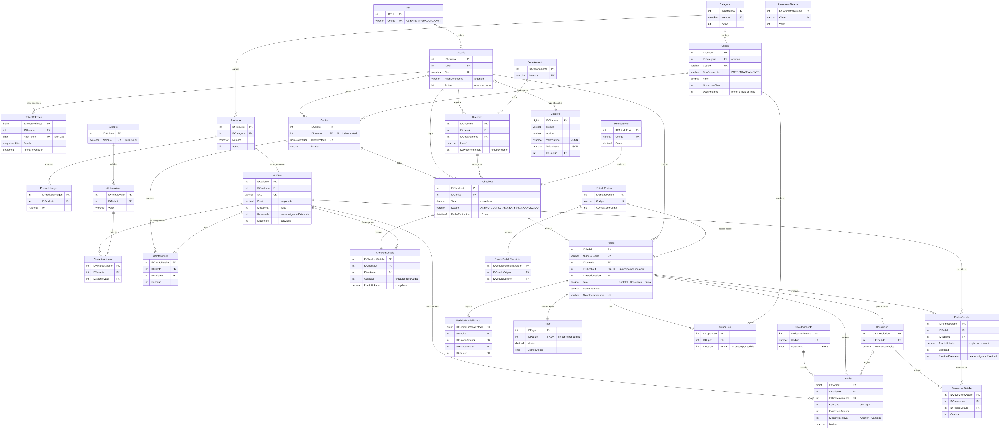

También en [SVG](docs/diagrama-er.svg) y en [Mermaid](docs/diagrama-er.mmd) (GitHub lo dibuja):

<details>
<summary>Ver el diagrama en Mermaid</summary>

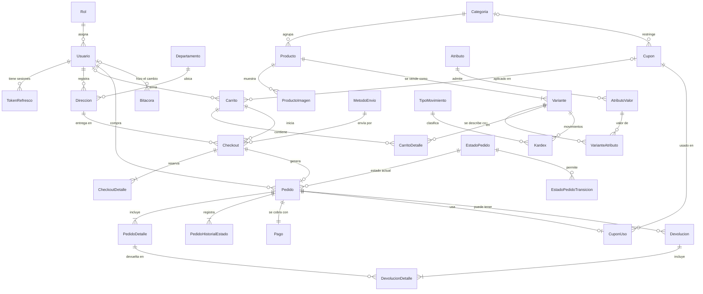

</details>

**31 tablas** en tercera forma normal, agrupadas por módulo:

| Módulo | Tablas |
|---|---|
| Seguridad | `Rol`, `Usuario`, `TokenRefresco` |
| Catálogo | `Categoria`, `Producto`, `ProductoImagen`, `Atributo`, `AtributoValor`, `Variante`, `VarianteAtributo` |
| Clientes | `Departamento`, `Direccion` |
| Cupones | `Cupon`, `CuponUso` |
| Carrito y checkout | `Carrito`, `CarritoDetalle`, `MetodoEnvio`, `Checkout`, `CheckoutDetalle` |
| Pedidos | `EstadoPedido`, `EstadoPedidoTransicion`, `Pedido`, `PedidoDetalle`, `PedidoHistorialEstado`, `Pago`, `Devolucion`, `DevolucionDetalle` |
| Inventario | `TipoMovimiento`, `Kardex` |
| Sistema | `Bitacora`, `ParametroSistema` |

Algunos puntos del modelo:

- **Producto vs. variante:** el producto es lo que se ve en el catálogo; la variante es lo que se vende, con su propio **SKU único, precio y existencia**. Los atributos (Talla, Color, Viscosidad, Presentación...) están normalizados en `Atributo`/`AtributoValor` y una variante no puede tener dos valores del mismo atributo (`UNIQUE (IDVariante, IDAtributo)`).
- **Montos** en `DECIMAL(12,2)` y cantidades en `INT`. No hay ni un `FLOAT` ni `REAL`.
- **Existencia física y reservada** en la variante; `Disponible = Existencia - Reservada` es una columna calculada persistida.
- **El pedido es una foto**: guarda precio, descuento, SKU, nombre, categoría y dirección del momento de la compra. Editar un producto, una dirección o un precio no cambia pedidos anteriores.
- **Fechas en UTC** (`DATETIME2(3)` con `SYSUTCDATETIME()`); el pedido tiene `FechaLocal` (día de Guatemala, UTC-6) persistida e indexada para los reportes.
- **Restricciones**: 31 PK, todas las FK, UNIQUE de negocio (SKU, correo, código de cupón, un checkout por pedido, un pago por pedido, un cupón por pedido), índices únicos filtrados (una dirección predeterminada por cliente, un carrito activo por cliente, un checkout activo por carrito) y CHECK donde aplica (montos que cuadran, `Reservada <= Existencia`, saldos de kardex, devoluciones ≤ vendido, porcentajes ≤ 100, vigencias coherentes).
- **Índices**: en `009_Indices.sql`, cada uno con un comentario de qué consulta atiende.

---

## 7. Ciclo de vida del pedido

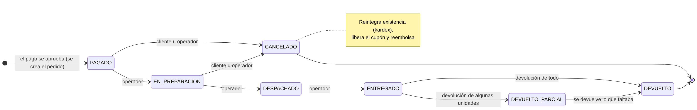

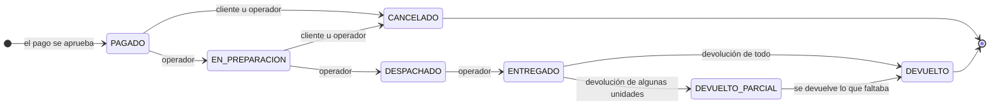

| Estado | Qué significa | ¿Cuenta en reportes? |
|---|---|---|
| `PAGADO` | el pago se aprobó y el pedido espera preparación (estado inicial) | sí |
| `EN_PREPARACION` | bodega lo está armando | sí |
| `DESPACHADO` | salió con el transportista (o está listo para recoger en la estación) | sí |
| `ENTREGADO` | el cliente lo recibió | sí |
| `DEVUELTO_PARCIAL` | se devolvió parte; cuenta solo lo neto | sí (neto) |
| `DEVUELTO` | se devolvió todo y se reembolsó el total | no |
| `CANCELADO` | se canceló antes del despacho | no |

- Las transiciones viven en la tabla **`EstadoPedidoTransicion`**. La API las valida (`pedidos/maquina-estados.ts`, que además revisa qué rol puede hacer cada paso) y la base las vuelve a validar con el trigger **`TR_Pedido_Estado`**: un `UPDATE` directo con una transición inválida se revierte.
- **Cada cambio** queda en `PedidoHistorialEstado` con usuario, fecha y hora, estado anterior y nuevo (lo inserta el trigger, así no se puede olvidar) y también en la bitácora.
- **Cancelar** (solo antes del despacho): reintegra la existencia con un movimiento `CANCELACION` en el kardex, revierte el uso del cupón y reembolsa el pago completo.
- **Devolver** (desde `ENTREGADO`): por línea, nunca más de lo vendido; reintegra existencia (`DEVOLUCION` en kardex) y reembolsa la parte proporcional de la línea. Si con eso se devuelve todo el pedido, también se reembolsa el envío y pasa a `DEVUELTO`.

---

## 8. Cómo se cumple cada regla del negocio

| Regla | Cómo lo resolví | Dónde |
|---|---|---|
| **No vender sin existencia aunque compren la última unidad al mismo tiempo** | Al iniciar el checkout se bloquean las variantes con `UPDLOCK` **siempre en orden de `IDVariante`** (evita deadlocks), se revisa lo disponible con las filas bloqueadas y se reserva todo o nada. El `CHECK Reservada <= Existencia` es la última barrera. | `SP_Inventario_ReservarExistencia`, `CK_Variante_Reservada` |
| **Respetar el precio y descuento que el cliente vio** | Al iniciar el checkout se copian precio y descuento a `CheckoutDetalle`; el pedido se crea con esos montos aunque el precio cambie después. | `SP_Checkout_Iniciar`, `SP_Pedidos_CrearPedido` |
| **Reserva de 15 minutos** | `Checkout.FechaExpiracion` (parámetro `SEGUNDOS_RESERVA_CHECKOUT` = 900). Un job la libera sola cada 15 s y además el pago revisa el vencimiento. | `SP_Inventario_LiberarReservasVencidas`, `jobs/liberar-reservas.ts` |
| **Sin pedidos ni cobros duplicados (doble clic / reintento)** | El pago exige `Idempotency-Key`. Misma clave → mismo pedido (200). Otra clave sobre un checkout ya pagado → mismo pedido. Dos solicitudes simultáneas → la segunda espera el `UPDLOCK` del checkout y lo encuentra completado. Y si todo eso fallara: `UNIQUE` en `Pedido.IDCheckout`, `Pedido(IDUsuario, ClaveIdempotencia)` y `Pago.IDPedido`. | `checkout.servicio.ts`, `SP_Pedidos_CrearPedido` |
| **Pedido atómico** | Pedido, detalle, kardex, uso de cupón, pago y cierre del checkout/carrito en **una transacción** con `XACT_ABORT ON`. Si falla cualquier paso, no se guarda nada. | `SP_Pedidos_CrearPedido` |
| **Límite total del cupón con concurrencia** | `UPDATE Cupon SET UsosActuales += 1 WHERE UsosActuales < LimiteUsosTotal` (atómico) + `CHECK UsosActuales <= LimiteUsosTotal`. El límite por cliente se cuenta con la fila del cupón ya bloqueada. | `SP_Pedidos_CrearPedido`, `CK_Cupon_Usos` |
| **Mensaje específico por cupón rechazado** | Una sola función evalúa las reglas en orden y devuelve código y mensaje (vencido, agotado, no vigente, mínimo con lo que falta, límite por cliente, sin productos de la categoría, inactivo). | `FU_Cupones_EvaluarCarrito` |
| **Descuento nunca negativo / un cupón por pedido** | `FU_Cupones_CalculoDescuento` topa el descuento al subtotal elegible; `CHECK Descuento <= Subtotal`; `Pedido.IDCupon` es una sola columna y `UNIQUE CuponUso.IDPedido`. | |
| **Totales sin errores de redondeo** | Toda la aritmética de dinero se hace en SQL Server con `DECIMAL`. El backend no suma ni multiplica montos. El descuento se reparte entre líneas truncando y los centavos que sobran van a la línea mayor; en devoluciones la última reembolsa exactamente lo que falta. | `SP_Checkout_Iniciar`, `SP_Devoluciones_Registrar` |
| **Existencia = suma del kardex** | Toda variación de existencia pasa por el kardex (incluida la existencia inicial). Cada fila guarda saldo anterior y nuevo con `CHECK Nueva = Anterior + Cantidad`. Vista de conciliación y endpoint `/api/inventario/conciliacion`. | `VW_Inventario_ConciliacionKardex` |
| **Ajuste manual con motivo y sin negativos** | El SP exige motivo y valida con la fila bloqueada que no quede negativo ni por debajo de lo reservado; `CHECK Existencia >= 0`. | `SP_Inventario_RegistrarMovimiento` |
| **Productos con ventas no se borran** | `SP_Catalogo_EliminarProducto` desactiva si hay ventas, movimientos o checkouts; solo borra si nunca tuvo historia. | |
| **Trazabilidad / bitácora** | Triggers en productos, variantes (precio, existencia, activación), categorías, cupones, usuarios, parámetros y estados de pedido. Guardan usuario (vía `SESSION_CONTEXT`), fecha, entidad, acción y valor anterior/nuevo en JSON. | `013_Triggers.sql` |
| **Bitácora inmutable** | No hay SP ni endpoint para modificarla; trigger `INSTEAD OF UPDATE, DELETE` que lanza error; el usuario de la app no tiene permisos sobre la tabla. Igual para kardex e historial de estados. | `TR_Bitacora_Inmutable` |
| **Reportes sin esperar reportes manuales** | SPs y vistas de dashboard, con caché invalidada en cada venta y aviso por WebSocket al dashboard. | `031_SP_Dashboard.sql`, `reportes.servicio.ts` |
| **Listados < 1 s** | Índices por consulta, paginación con `OFFSET/FETCH`, `OPTION (RECOMPILE)` en filtros opcionales, RCSI para que las lecturas no esperen a las escrituras. Hay una prueba automática que mide los tiempos. | `009_Indices.sql` |

---

## 9. Seguridad

### SQL injection: ni una línea de SQL en el backend

1. **El backend no contiene SQL.** `db/ejecutor.ts` hace `request.execute('SP_...')`, que viaja como **llamada RPC** del protocolo TDS: el nombre del procedimiento y cada parámetro van por separado y tipados (`Int`, `NVarChar(150)`, `Decimal(12,2)`...). No existe texto SQL donde inyectar algo.
2. **Los nombres de SP salen de un catálogo fijo** (`db/procedimientos.ts`). TypeScript no compila si se pasa otro nombre y en ejecución se vuelve a revisar.
3. **Ningún SP usa SQL dinámico.** Los filtros opcionales son condiciones `(@Param IS NULL OR Columna = @Param)` con `OPTION (RECOMPILE)` y el ordenamiento usa `CASE` sobre valores validados. Si en el futuro hiciera falta SQL dinámico, sería con `sp_executesql` y parámetros.
4. **Las listas viajan como parámetros tabla (TVP)** tipados, no como strings separados por coma.
5. **Comodines de búsqueda escapados**: si alguien busca `%` o `_` se busca literalmente (`FU_Sistema_PatronBusqueda`).
6. **Mínimo privilegio**: la API se conecta con `shopcart_app`, que solo tiene `EXECUTE` sobre los SPs públicos (con `DENY` sobre tablas, vistas y SPs internos). Aunque alguien lograra mandar SQL por esa conexión, no podría leer `Usuario` ni borrar la bitácora (`database/pruebas/03`).
7. Hay una **prueba automática** que revisa todo `src/` y falla si encuentra `SELECT`, `INSERT`, `UPDATE`, `DELETE`, `EXEC`, `.query(` o `.batch(`.

### Autenticación y autorización

- Contraseñas con **argon2id** (19 MiB, 2 iteraciones, parámetros de OWASP). Si el correo no existe igual se verifica contra un hash ficticio para que el tiempo de respuesta no revele qué correos están registrados.
- **Access token JWT** de 15 minutos, HS256 forzado al verificar (no acepta `alg: none` ni otros algoritmos), con emisor y audiencia.
- **Refresh token** opaco de 256 bits en cookie `httpOnly` + `SameSite=Strict` limitada a `/api/auth`; en la base solo se guarda su SHA-256. **Se rota en cada uso** y, si alguien presenta uno ya rotado, se revoca toda la familia (la sesión se cierra en todos lados). Margen de 10 s para dos pestañas que refrescan a la vez.
- En cada solicitud se confirma que el usuario siga activo y se toma **su rol actual de la base** (caché de 30 s que se invalida al desactivar o cambiar rol). Un usuario desactivado pierde el acceso al instante y su WebSocket se cierra.
- Roles: **Cliente** compra y ve lo suyo; **Operador** gestiona pedidos, devoluciones e inventario; **Administrador** además catálogo, precios, cupones, usuarios, parámetros, reportes y bitácora. El personal no compra con su cuenta de trabajo.
- **Aislamiento entre clientes**: el ID del usuario siempre sale del token, nunca del body; cada SP filtra por dueño. Pedido/dirección/checkout de otro → **403**; inexistente → 404. El carrito no se pide por ID. Los esquemas son estrictos: un campo de más (por ejemplo `idUsuario`) se rechaza con 400.
- Token vencido → **401** `TOKEN_EXPIRADO`; sin token → 401; rol sin permiso → **403**.

### HTTP

- `helmet` (CSP, HSTS, `nosniff`, `X-Frame-Options`...), `X-Powered-By` desactivado.
- CORS con **lista blanca** (`CORS_ORIGINS`) y credenciales.
- **Rate limiting**: 10 intentos **fallidos** de login por IP cada 15 min (quien entra bien no se bloquea), 5 registros por IP cada 15 min, 60 renovaciones de sesión.
- Cuerpo JSON limitado a 100 kb; errores internos nunca exponen detalles de SQL Server (solo van al log con su `idSolicitud`).
- Logs con tokens, cookies, contraseñas y datos de tarjeta ocultos.
- Sin credenciales en el repositorio: todo sale de variables de entorno (`.env` está en `.gitignore`); la configuración se valida con Zod al arrancar.

---

## 10. Tiempo real

Socket.IO en el mismo puerto de la API. El cliente se conecta con `io('http://localhost:3000', { auth: { token } })`; sin token entra como visitante.

| Evento | Lo recibe | Cuándo |
|---|---|---|
| `inventario:existencia` | todos (sala `catalogo`) | cambia lo disponible de una variante (reserva, venta, cancelación, devolución, ajuste, reserva vencida) |
| `catalogo:actualizado` | todos | se crea o modifica un producto, variante, precio o categoría |
| `pedido:creado` | operadores, administradores y el cliente | se paga un pedido |
| `pedido:estado` | el cliente dueño y el personal | cambia el estado de un pedido |
| `dashboard:actualizar` | administradores | algo cambió las ventas (agrupado en 1 s) |
| `carrito:actualizado` | el cliente | sincroniza su carrito entre pestañas o dispositivos |
| `checkout:expirado` | el cliente | venció su reserva de 15 minutos |
| `sesion:revocada` | el usuario | un admin lo desactivó; se cierra el socket |
| `sesion:expirada` | el usuario | venció su token; el frontend se reconecta con el renovado |

Los eventos se emiten **después** de que la base confirmó la transacción, así nadie se entera de algo que se revirtió.

**En el frontend:**

- Hay una sola conexión, en el mismo origen (`/socket.io`), con el token en el handshake.
- Se reconecta al iniciar o cerrar sesión y cuando el token se renueva.
- `tiempo-real/sincronizador.tsx` traduce cada evento a la consulta de TanStack Query que hay que refrescar:

| Evento | Qué se actualiza en pantalla |
|---|---|
| `inventario:existencia` | lo disponible en el catálogo, el detalle (al instante, sin pedirlo de nuevo), el carrito y el inventario del panel |
| `catalogo:actualizado` | catálogo, detalle y categorías |
| `pedido:creado` | listas de pedidos, con aviso "Nuevo pedido" al personal |
| `pedido:estado` | el detalle y la línea de tiempo del pedido, con aviso al cliente |
| `dashboard:actualizar` | indicadores y gráficas del dashboard |
| `carrito:actualizado` | el carrito en las otras pestañas del cliente |
| `checkout:expirado` | el checkout pasa a "Tu reserva venció" |
| `sesion:revocada` | se cierra la sesión y se manda al login con aviso |

---

## 11. API

Documentación interactiva completa en **`/api/docs`** (OpenAPI 3.1 generado desde los mismos esquemas de validación; también en `/api/openapi.json`). Para probar rutas protegidas: `POST /api/auth/login`, copia el `accessToken` y pégalo en **Authorize**.

### Endpoints (77)

| Módulo | Endpoints | Acceso |
|---|---|---|
| Autenticación | `POST /api/auth/registro`, `/login`, `/refresh`, `/logout`, `GET /perfil` | público / autenticado |
| Usuarios | `GET/POST /api/usuarios`, `GET/PUT /:id`, `PATCH /:id/estado` | Admin |
| Categorías | `GET /api/categorias`, `GET /:id`, `POST`, `PUT /:id`, `PATCH /:id/estado`, `DELETE /:id` | público / Admin |
| Productos | `GET /api/productos` (q, idCategoria, precioMin, precioMax, disponible, ordenarPor, direccion, pagina, tamanoPagina), `GET /:id`, `POST`, `PUT /:id`, `PUT /:id/imagenes`, `PATCH /:id/estado`, `DELETE /:id`, `POST /:id/variantes` | público / Admin |
| Variantes y atributos | `PATCH /api/variantes/:id/precio`, `PATCH /:id/estado`, `GET /api/atributos` | Admin / personal |
| Inventario | `GET /api/inventario/existencias`, `POST /movimientos`, `GET /kardex`, `GET /conciliacion`, `GET /tipos-movimiento` | Operador, Admin |
| Direcciones | `GET/POST /api/direcciones`, `GET/PUT/DELETE /:id`, `PATCH /:id/predeterminada` | Cliente |
| Carrito | `GET/DELETE /api/carrito`, `POST /items`, `PATCH/DELETE /items/:idVariante`, `POST/DELETE /cupon`, `POST /fusionar` | Cliente o invitado (`X-Carrito-Token`) |
| Cupones | `GET/POST /api/cupones`, `GET/PUT/DELETE /:id`, `PATCH /:id/estado`, `GET /:id/usos` | Admin |
| Checkout | `POST /api/checkout`, `GET/DELETE /:id`, `POST /:id/pagar` (encabezado `Idempotency-Key`) | Cliente |
| Pedidos | `GET /api/pedidos/mios`, `GET /api/pedidos` (estado, cliente, idCliente, desde, hasta, orden, paginación), `GET /:id`, `PATCH /:id/estado`, `POST /:id/cancelar`, `POST/GET /:id/devoluciones` | según rol |
| Reportes | `GET /api/reportes/resumen`, `/ventas?agrupacion=dia|semana|mes`, `/ventas-por-categoria`, `/top-productos`, `/carritos-abandonados` | Admin |
| Bitácora | `GET /api/bitacora` (modulo, entidad, idEntidad, accion, idUsuario, desde, hasta), `GET /modulos` | Admin |
| Sistema | `GET /api/salud`, `GET /api/catalogos/departamentos`, `/metodos-envio`, `/estados-pedido`, `GET/PUT /api/parametros` | público / Admin |

### Formato de respuestas

```jsonc
// Éxito
{ "datos": { ... } }
// Listados
{ "datos": [ ... ], "paginacion": { "pagina": 1, "tamanoPagina": 20, "totalRegistros": 171, "totalPaginas": 9 } }
// Error (siempre igual)
{ "error": { "codigo": "STOCK_INSUFICIENTE", "mensaje": "Ya no hay suficientes unidades disponibles: ...", "detalles": [ ... ], "idSolicitud": "…" } }
```

### Catálogo de errores

Los SPs lanzan errores de negocio con `THROW` y un número propio; `db/errores-bd.ts` los traduce a HTTP. El mensaje que ve el usuario lo redacta el SP.

| HTTP | Códigos |
|---|---|
| 400 | `VALIDACION`, `SOLICITUD_INVALIDA`, `JSON_INVALIDO`, `ROL_INVALIDO`, `PRODUCTO_SIN_VARIANTES`, `PRECIO_INVALIDO`, `TIPO_MOVIMIENTO_INVALIDO`, `MOTIVO_REQUERIDO`, `DEPARTAMENTO_INVALIDO`, `METODO_ENVIO_INVALIDO`, `ESTADO_INVALIDO`, `LINEA_NO_PERTENECE_AL_PEDIDO`, `DEVOLUCION_SIN_LINEAS`, `PARAMETRO_FUERA_DE_RANGO` |
| 401 | `TOKEN_REQUERIDO`, `TOKEN_INVALIDO`, `TOKEN_EXPIRADO`, `SESION_REVOCADA`, `CREDENCIALES_INVALIDAS`, `REFRESH_*`, `SESION_REQUERIDA` |
| 402 | `PAGO_RECHAZADO` |
| 403 | `ACCESO_DENEGADO` (rol sin permiso o recurso de otro cliente), `CUENTA_DESACTIVADA`, `BITACORA_INMUTABLE`, `KARDEX_INMUTABLE` |
| 404 | `*_NO_ENCONTRADO/A`, `CUPON_NO_EXISTE`, `PRODUCTO_NO_EN_CARRITO`, `RUTA_NO_ENCONTRADA` |
| 409 | `STOCK_INSUFICIENTE`, `CANTIDAD_EXCEDE_DISPONIBLE`, `EXISTENCIA_NEGATIVA`, `EXISTENCIA_RESERVADA`, `TRANSICION_NO_PERMITIDA`, `PEDIDO_NO_CANCELABLE`, `PEDIDO_NO_DEVOLVIBLE`, `DEVOLUCION_EXCEDE_VENDIDO`, `RESERVA_EXPIRADA`, `CHECKOUT_NO_ACTIVO`, `IDEMPOTENCIA_CONFLICTO`, `SKU_DUPLICADO`, `CORREO_YA_REGISTRADO`, `CUPON_DUPLICADO`... |
| 422 | `CUPON_VENCIDO`, `CUPON_AGOTADO`, `CUPON_NO_VIGENTE`, `CUPON_MONTO_MINIMO`, `CUPON_LIMITE_CLIENTE`, `CUPON_SIN_PRODUCTOS_ELEGIBLES`, `CUPON_INACTIVO`, `CARRITO_VACIO`, `PRODUCTO_NO_DISPONIBLE` |
| 429 | `DEMASIADOS_INTENTOS` |
| 503 | `CONFLICTO_DE_CONCURRENCIA` (deadlock después de 3 reintentos), `BASE_DATOS_NO_DISPONIBLE` |

---

## 12. Decisiones técnicas y supuestos

El enunciado deja algunas cosas abiertas a propósito. Estas son las posturas que tomé:

1. **¿Cuándo nace el pedido?** Cuando el pago se aprueba. Antes de eso existe el **checkout**, que es la "reserva de existencia" del glosario: congela precios y aparta unidades por 15 minutos. Así no hay pedidos "pendientes de pago" ensuciando los reportes, y la creación del pedido (pedido + detalle + kardex + cupón + pago) es un solo paso atómico.
2. **¿Qué es "pedido completado" para los reportes?** Un pedido cuyo pago se completó y que no fue cancelado ni devuelto por completo, siempre **restando lo devuelto**. Las ventas se ubican en el día en que se hizo el pedido (hora de Guatemala). Ticket promedio = ventas netas / pedidos que cuentan.
3. **Precio y descuento congelados al iniciar el checkout.** Al pagar solo se vuelven a validar los recursos compartidos (unidades ya reservadas y usos del cupón). Si el cupón se agotó mientras el cliente pagaba, el pago se rechaza sin crear nada.
4. **Si el carrito cambia con un checkout activo, ese checkout se cancela** y su reserva se libera: el resumen congelado ya no coincidiría con el carrito.
5. **Cupones:** aplican solo a productos (no al envío); el monto mínimo se compara contra el subtotal del carrito; un cupón por categoría descuenta solo esas líneas; requieren sesión (por el límite por cliente). Si el pedido se cancela, el uso del cupón se devuelve; si se hace una devolución, no.
6. **Devoluciones** las registra el operador o administrador al recibir el producto (en las estaciones así funciona). Reembolso proporcional al total de la línea (ya con su parte del descuento). Si se devuelve todo, también se reembolsa el envío.
7. **El cliente puede cancelar** mientras el pedido esté `PAGADO` o `EN_PREPARACION` ("mientras no haya sido despachado").
8. **Invitados:** pueden armar carrito con un token (UUID); para pagar inician sesión y el carrito se fusiona (si al sumar se pasa de lo disponible, se ajusta).
9. **Solo el rol Cliente compra.** El personal usa una cuenta de cliente si quiere comprar.
10. **Recurso de otro cliente → 403** (como dice el criterio de aceptación); si el recurso no existe → 404. Los IDs son secuenciales, así que la existencia no es un secreto.
11. **IVA 12 % incluido** en los precios; el pedido guarda el desglose `BaseImponible = ROUND(Total / 1.12, 2)` y `MontoIVA = Total - BaseImponible`.
12. **Envío** con costo fijo por método (estándar Q35, express Q60, recoger en estación Q0). Elegir la estación exacta necesitaría una tabla de estaciones; queda como mejora.
13. **Pago simulado**: la pasarela valida Luhn y vencimiento, tiene tarjetas de prueba de rechazo y nunca guarda el número completo ni el CVV. En producción el orden sería autorizar → crear pedido → capturar.
14. **Parámetros configurables** en `ParametroSistema` (duración de la reserva, horas para carrito abandonado, umbral de existencia baja), editables por el admin y con bitácora.
15. **Categorías de un solo nivel** y un producto pertenece a una categoría.
16. **Imágenes por URL** (no hay subida de archivos en esta fase).
17. **Los usuarios, direcciones, productos y cupones con historia no se borran**: se desactivan.
18. **Una sola instancia de la API**: la caché de reportes, el estado de usuarios y el rate limit están en memoria. Para escalar a varias instancias se moverían a Redis (y Socket.IO usaría su adaptador de Redis).
19. **SQL Server 2022 en Docker con compatibilidad 150**: no uso funciones exclusivas de 2022 (`GREATEST`, `GENERATE_SERIES`, `DATE_BUCKET`...), así que todo corre en 2019.
20. **Collation `Modern_Spanish_CI_AI`**: la ñ ordena bien y las búsquedas no distinguen mayúsculas ni tildes.

---

## 13. Estándar de nomenclatura

| Objeto | Formato | Ejemplos en el proyecto |
|---|---|---|
| Stored procedure | `SP_Modulo_Proceso` | `SP_Pedidos_CrearPedido`, `SP_Inventario_ReservarExistencia`, `SP_Carrito_AplicarCupon` |
| Vista | `VW_Modulo_Proceso` | `VW_Dashboard_VentasPorCategoria`, `VW_Pedidos_Historial`, `VW_Inventario_ConciliacionKardex` |
| Función tipo tabla | `FU_Modulo_Proceso` | `FU_Cupones_CalculoDescuento`, `FU_Carrito_Resumen`, `FU_Pedidos_DesgloseIVA` |
| Llave primaria | `ID` + Tabla | `IDProducto`, `IDCarrito`, `IDPedido`, `IDCupon` |
| Tipo tabla (extensión mía) | `TT_Modulo_Nombre` | `TT_Catalogo_Variante`, `TT_Devoluciones_Linea` |
| Trigger (extensión mía) | `TR_Tabla_Proposito` | `TR_Pedido_Estado`, `TR_Bitacora_Inmutable` |
| Restricciones | `PK_`, `FK_Tabla_Ref`, `UQ_`, `UX_` (único filtrado), `CK_`, `DF_`, `IX_` | `CK_Variante_Reservada`, `UQ_Pago_Pedido` |

Todos los objetos se crean con scripts escritos a mano; no hay ORM.

---

## 14. Qué sigue / mejoras posibles

- Exportar reportes a PDF y en formato .xlsx nativo (hoy se exportan a CSV, que Excel abre directo).
- Elegir la estación exacta para recoger (necesita una tabla de estaciones con horarios y existencia por estación).
- Vender combustible, vales prepagados o servicios: no tienen envío, kardex ni devolución por línea como un producto, así que requieren su propio modelo.
- Pruebas de punta a punta en el navegador con Playwright dentro del pipeline (el flujo de compra, el tiempo real y la revocación de sesión ya se probaron así durante el desarrollo).
- Búsqueda con Full-Text Search de SQL Server cuando el catálogo crezca.
- Redis para caché, rate limit y Socket.IO si se corren varias instancias.
- Pasarela de pago real con autorización/captura y webhooks.
- Flujo de solicitud de devolución por parte del cliente y subida de imágenes a almacenamiento de archivos.
